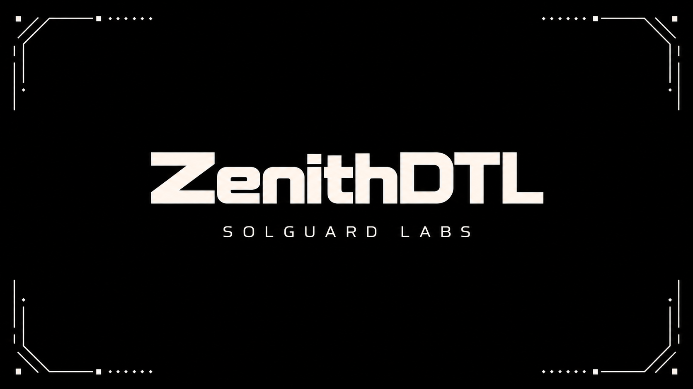
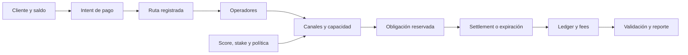

# ZenithDTL



ZenithDTL es un motor de liquidación entre dominios con operadores, canales y rutas de uno o varios saltos. La capacidad operativa se distribuye por época a partir de stake, reputación, estado del operador y demanda de canales. El núcleo Go conserva balances, reservas y obligaciones; una CLI produce informes JSON deterministas para conciliación y supervisión.

## Flujo económico



Cada obligación reserva el bruto (`importe + fee`) del pagador y una cantidad por canal. Al liquidarse, se acredita el importe al beneficiario y se distribuyen fees por salto. Las obligaciones canceladas o expiradas liberan las reservas de cuenta y canal. El cambio de época incorpora señales de reputación y publica un plan de capacidad.

```text
capacidad de canal disponible = max(límite − usado − reservado − en_vuelo, 0)
deuda activa = reservado + en_vuelo
headroom asignado = max(límite agregado − exposición abierta, 0)
utilización (bps) = exposición abierta × 10 000 / límite agregado
```

`capacity` en el reporte reúne por operador score, banda, plan, recomendación, límite asignado, exposición abierta y headroom de canales. Son vistas de seguimiento; una recomendación no es una transferencia liquidada. Consulte el [modelo económico](docs/modelo-economico.md) para los cálculos y ejemplos.

## Primer uso

Requisitos: Go 1.22+, Node.js 24+.

```bash
npm ci
npm run build
out/zenithdtl list
out/zenithdtl run balanced-reputation --json
out/zenithdtl validate route-withdrawal
npm test
```

En Windows el binario es `out/zenithdtl.exe`; puede usarse `npm.cmd` si PowerShell bloquea el alias de npm. El comando `list` enumera escenarios deterministas; `run` genera un reporte estructurado y `validate` comprueba conservación, rutas y referencias.

## Estructura y documentación

| Área | Responsabilidad |
| --- | --- |
| `src/ledger.go`, `src/settlement.go` | Cuentas, reservas, obligaciones y fees. |
| `src/reputation.go`, `src/operators.go` | Scorecards, planes y límites de canales. |
| `src/routes.go`, `src/withdrawals.go` | Conectividad, precios de ruta y colas de retirada. |
| `src/capacity_digest.go`, `src/report.go` | Conciliación de capacidad y salida JSON. |
| `cmd/zenithdtl` | Interfaz de línea de comandos. |

- [Arquitectura y ciclo de época](docs/arquitectura.md)
- [Modelo económico](docs/modelo-economico.md)
- [Operación y recuperación](docs/operacion.md)
- [Contrato de reporte](docs/contrato-json.md)
- [Política de seguridad](SECURITY.md)

La integración local no conecta custodios ni ejecuta contratos externos. `scripts/ci.sh` valida formato Go, build, pruebas Go, `go vet` y pruebas TypeScript. La entrega estable exige que `main`, `production` y el tag anotado `v1.0.0` apunten al mismo commit.
