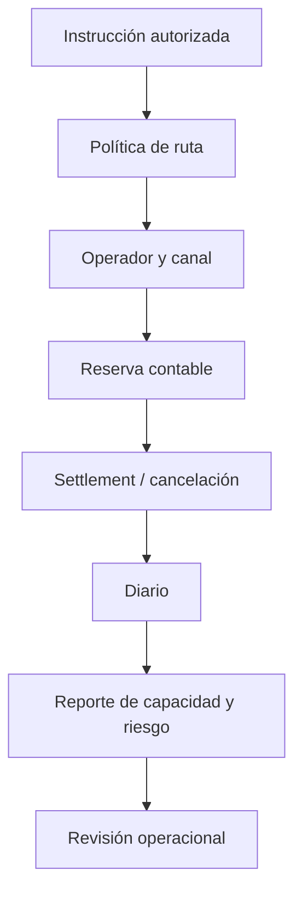

# Política de seguridad

## Límites de confianza

ZenithDTL recibe instrucciones de un entorno operacional externo. La CLI local no autentica usuarios, no firma transacciones y no demuestra finalización en una red. Su alcance verificable son las transiciones del ledger, la política de rutas, la capacidad de canales, las colas de retirada y los reportes reproducibles. Una integración real debe aportar autenticación, idempotencia, custodia y conciliación independiente.



## Controles comprobables

- Los IDs de ruta y canal enlazan dominios compatibles y activos registrados.
- Una obligación registra bruto, fee y asignaciones de cada canal; la cuenta pagadora conserva la reserva hasta el estado terminal.
- La admisión local exige canal habilitado y disponibilidad para el importe de su salto.
- Las scorecards usan un score de 0 a 1000 con ajustes por época y bandas visibles.
- Los retiros de bóveda se mantienen en cola hasta cumplir el plazo configurado.
- Los reportes separan límite planificado, recomendado y asignado, exposición y capacidad disponible; `validate` revisa conservación y consistencia estructural.

La conservación contable y los límites por canal son controles acotados. No sustituyen una auditoría de seguridad independiente ni prueban que todas las obligaciones futuras puedan ser cubiertas externamente.

## Comunicación responsable

Use el canal privado de avisos de seguridad del repositorio. Incluya commit, comando, escenario, secuencia de épocas, IDs de operador/ruta/canal, unidades, estado esperado y observado e impacto económico estimado. No envíe secretos ni pruebe sobre sistemas ajenos.

```bash
go test ./...
go vet ./...
npm run ci
out/zenithdtl validate capacity-limits
```

El [modelo económico](docs/modelo-economico.md) define unidades y exposición; [operación](docs/operacion.md) describe los controles de seguimiento.
