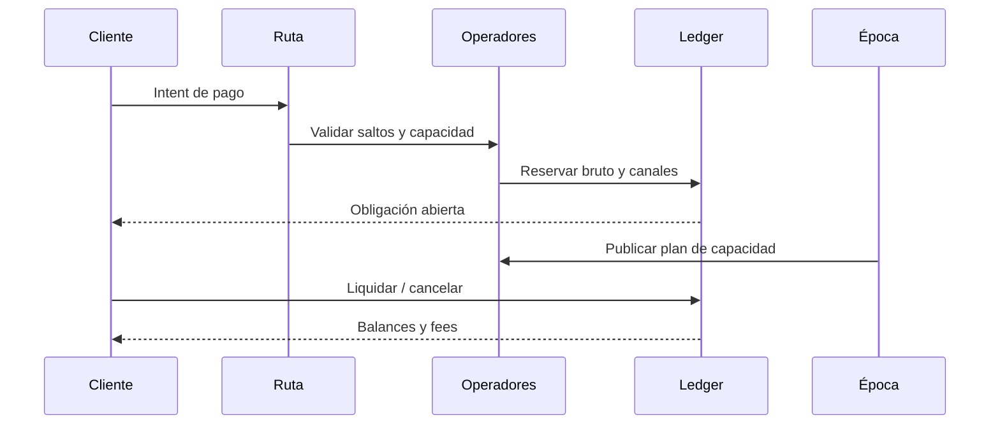
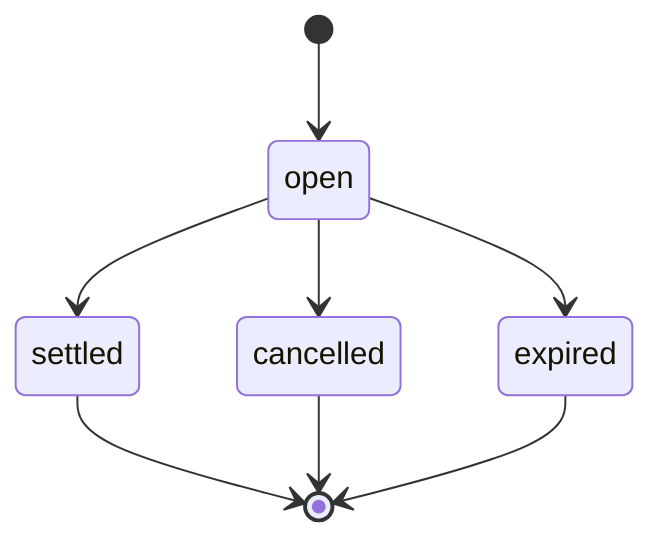

# Arquitectura y ciclo de época

El protocolo mantiene cinco libros: ledger de cuentas/bóvedas, scorecards de reputación, registro de operadores y canales, catálogo de rutas y obligaciones de settlement. `Protocol` coordina las transiciones y el diario emite eventos con época y referencia. La CLI construye escenarios reproducibles sin conexión a servicios externos.

Cada ruta registra origen, destino, activo, uno o más saltos, máximo de fee y mínimo de score. Un canal pertenece a un operador y mantiene `used`, `reserved` e `inFlight`. El planificador reparte la capacidad del operador entre canales ponderando modo y prioridad. Un canal no puede rebajarse por debajo de su deuda activa al aplicar un nuevo límite.

En el cierre de época se procesan vencimientos, retiros listos, planes y ajustes de reputación. La reputación usa entradas diferidas con `deferredTo`; una observación operativa y su efecto en el score pueden pertenecer a épocas distintas. Por eso los reportes exponen plan, score, recomendación, capacidad asignada y exposición como magnitudes independientes.

`BuildCapacityDigest` consolida por operador la vista de canales y obligaciones abiertas. Ordena por ID para garantizar JSON estable. No reserva capacidad ni cambia las reglas de admisión; es una lectura operacional.
